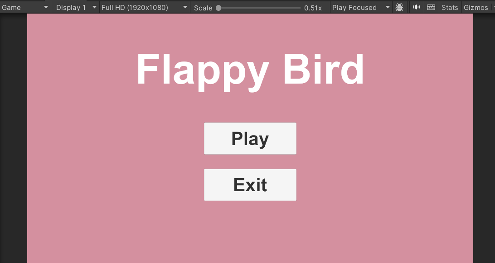
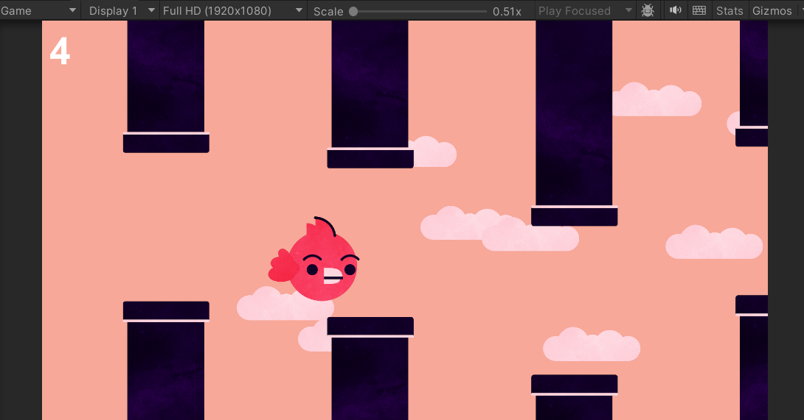

# Flappy Bird – Unity 2D

A Flappy Bird–style endless runner built in Unity as the first lab project of the Game Programming course at İstanbul Kültür University (SEN0416).

  
  

## Gameplay

The bird moves forward automatically. Press **Space** to flap upward; gravity pulls it back down. Fly through the gaps between endless pipes — each pair you pass earns one point. Touching a pipe or the ground ends the game.

## Features

- **Two scenes:** Welcome menu (Play / Exit) and the Main game scene
- **Physics-based bird** using Rigidbody2D, with a wing-flapping sprite animation
- **Endless pipe generation** at random heights, destroyed once off-screen
- **Parallax clouds** spawned at random positions, moving slower than the pipes
- **Score system** using trigger colliders placed between each pipe pair
- **Game Over panel** with a Play Again button that reloads the scene
- **Sound effect hooks** for swoosh, flap, point, collision and die events

## Scripts

| Script | Responsibility |
|---|---|
| `Bird.cs` | Input, jumping, collision/game over, scoring, sounds, restart |
| `PipeMove.cs` | Moves an object left at a set speed and destroys it off-screen (reused for clouds) |
| `PipeSpawner.cs` | Spawns a prefab at a fixed interval with a random Y offset (reused for clouds) |
| `WelcomeMenu.cs` | Play and Exit button actions on the Welcome scene |

## Built With

- Unity 2022.3.62f2 (LTS), 2D Built-in Render Pipeline
- C#

## How to Run

1. Clone the repository.
2. Open the folder in Unity Hub with **Unity 2022.3.62f2**.
3. Open `Assets/Scenes/Welcome.unity` and press Play.
